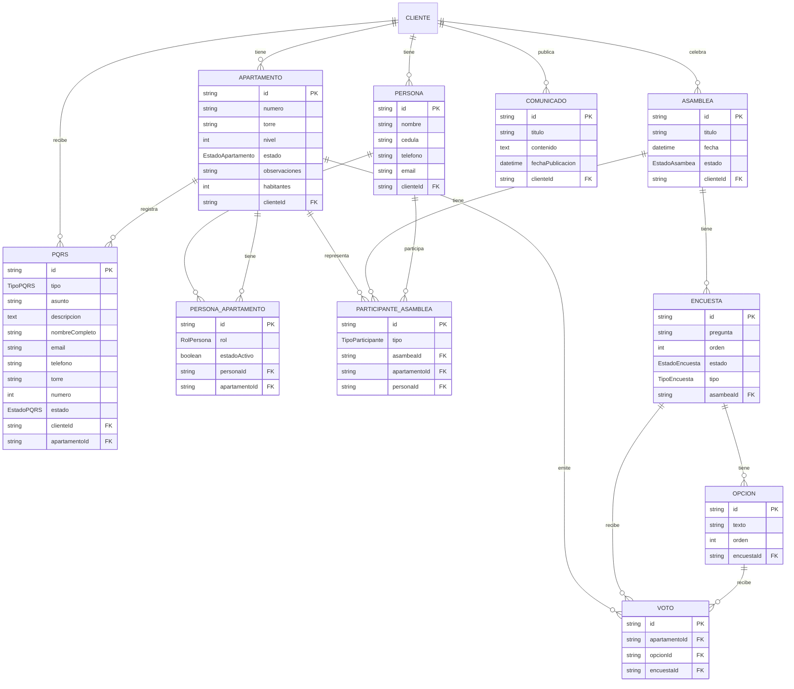

# Sistema GAPH - Gestión de Apartamentos y Asambleas

Sistema de gestión para unidades residenciales con funcionalidades de administración de apartamentos, personas, asambleas, voting digital, comunicados y PQRS.

## Características

### Panel de Administración (`/dashboard`)
- **Apartamentos**: CRUD de apartamentos con número, torre y nivel
- **Personas**: Gestión de residentes con identificación
- **Asambleas**: 
  - Crear y gestionar asambleas
  - Registrar participantes (nombre, cédula, torre, apartamento)
  - Crear encuestas (binarias o múltiples)
  - Votación en tiempo real
  - **Resultados con gráficos visuales** y botón de actualizar
- **Comunicados**: Publicación de anuncios a residentes
- **PQRS**: Gestión de peticiones, quejas, reclamos y sugerencias con cambio de estado

### Portal Público
- **Selección de unidad residencial**: Pantalla de bienvenida para seleccionar la comunidad
- **Identificación de participante**: Login mediante cédula
- **Votación**: Acceso a encuestas activas de la asamblea
- **PQRS público**: Formulario sin login para enviar solicitudes (tipo, asunto, descripción, nombre, torre, apartamento, email, teléfono)

## Tech Stack

- **Framework**: Next.js 16 (App Router)
- **UI**: React 19 + Tailwind CSS + shadcn/ui
- **Base de datos**: PostgreSQL + Prisma ORM
- **Autenticación**: NextAuth.js (en desarrollo)
- **Runtime**: Bun
- **Testing**: Vitest (unit/integration) + Playwright (E2E)

## Estructura del Proyecto

```
src/
├── app/
│   ├── (admin)/          # Rutas del panel de administración
│   │   ├── dashboard/    # Dashboard principal
│   │   ├── personas/     # Gestión de personas
│   │   ├── apartamentos/ # Gestión de apartamentos
│   │   ├── asambleas/   # Gestión de asambleas y encuestas
│   │   │   └── [id]/
│   │   │       └── resultados/ # Página de resultados
│   │   ├── comunicados/ # Gestión de comunicados
│   │   └── pqrs/        # Lista y gestión de PQRS
│   ├── (public)/         # Rutas públicas
│   │   ├── page.tsx     # Landing page con selector de unidad
│   │   ├── unidad/      # Portal por unidad residencial
│   │   ├── votar/      # Sistema de votación público
│   │   └── contacto/   # Formulario público de PQRS
│   └── api/             # API routes (auth, etc.)
├── components/
│   └── ui/              # Componentes shadcn/ui
└── lib/
    ├── actions/         # Server Actions de Next.js
    ├── schemas/         # Validación Zod
    └── db.ts            # Cliente Prisma
```

## Entidades y Relaciones

### Modelo Entidad-Relación



### Descripción de Entidades

| Entidad | Descripción | Atributos Principales |
|---------|-------------|---------------------|
| **Cliente** | Unidad residencial o conjunto | `id`, `nombre` |
| **Apartamento** | Unidad habitacional | `numero`, `torre`, `nivel`, `estado` (PROPIO/ARRIENDO/VACIO) |
| **Persona** | Residente o propietario | `nombre`, `cedula`, `telefono`, `email` |
| **PersonaApartamento** | Relación Persona-Apartamento | `rol` (PROPIETARIO/APODERADO/RESIDENTE), `estadoActivo` |
| **Asambea** | Junta de propietarios | `titulo`, `fecha`, `estado` (ABIERTA/CERRADA) |
| **ParticipanteAsambea** | Participante registrado en asamblea | `tipo` (PROPIETARIO/APODERADO) |
| **Encuesta** | Sondeo en una asamblea | `pregunta`, `tipo` (BINARIA/MULTIPLE), `estado` (ACTIVA/CERRADA) |
| **Opcion** | Opción de respuesta | `texto`, `orden` |
| **Voto** | Voto registrado | Único por (apartamento, encuesta) |
| **Comunicado** | Anuncio publicado | `titulo`, `contenido`, `fechaPublicacion` |
| **PQRS** | Petición/Queja/Reclamo/Sugerencia | `tipo`, `asunto`, `descripcion`, `estado` |

### Enums (Valores permitidos)

| Enum | Valores |
|------|---------|
| **EstadoApartamento** | `PROPIO`, `ARRIENDO`, `VACIO` |
| **RolPersona** | `PROPIETARIO`, `APODERADO`, `RESIDENTE` |
| **EstadoAsambea** | `ABIERTA`, `CERRADA` |
| **TipoParticipante** | `PROPIETARIO`, `APODERADO` |
| **EstadoEncuesta** | `ACTIVA`, `CERRADA` |
| **TipoEncuesta** | `BINARIA`, `MULTIPLE` |
| **TipoPQRS** | `PREGUNTA`, `QUEJA`, `RECLAMO`, `SUGERENCIA` |
| **EstadoPQRS** | `PENDIENTE`, `RESUELTO`, `RECHAZADO`, `SIN_LEER` |
| **Role** | `USER`, `ADMIN` |

### Reglas de Negocio Clave

1. **Un apartamento = un voto por encuesta**: La tabla `Voto` tiene índice único en `(apartamentoId, encuestaId)` para garantizar que cada apartamento vote solo una vez por pregunta.

2. **Un representante por apartamento en asamblea**: La tabla `ParticipanteAsambea` tiene índice único en `(asambeaId, apartamentoId)` para que solo un representante vote por apartamento.

3. **Una persona por cédula por cliente**: La tabla `Persona` tiene restricción única en `(cedula, clienteId)` para evitar duplicados.

4. **Apartamento único por torre y número**: La tabla `Apartamento` tiene restricción única en `(numero, torre, clienteId)`.

## Testing

El proyecto cuenta con una suite completa de testing:

### Tests Unitarios (Vitest) - 62 tests

```bash
bun test
```

| Carpeta | Descripción | Tests |
|---------|-------------|-------|
| `tests/schemas/` | Validación de Zod schemas | 39 |
| `tests/actions/` | Server Actions mockeadas | 23 |

### Tests E2E (Playwright) - 8 tests

```bash
bun run test:e2e
```

Los tests E2E cubren:
- Login y autenticación
- Navegación entre páginas
- Formulario público de PQRS

### Scripts de Testing

| Comando | Descripción |
|---------|-------------|
| `bun test` | Tests unitarios (schemas + actions) |
| `bun test:coverage` | Coverage de tests unitarios |
| `bun run test:e2e` | Tests E2E automatizados |
| `bun run test:e2e:ui` | Tests E2E con UI interactiva |

## Primeros Pasos

### Requisitos Previos
- Node.js 18+ o Bun
- PostgreSQL

### Instalación

1. Clonar el repositorio:
```bash
git clone <repo-url>
cd sistema-gaph
```

2. Instalar dependencias:
```bash
bun install
# o
npm install
```

3. Configurar variables de entorno:
```bash
cp .env.example .env
# Editar .env con las credenciales de PostgreSQL
```

4. Generar el cliente Prisma:
```bash
npx prisma generate
```

5. Aplicar migraciones:
```bash
npx prisma migrate dev
```

6. Iniciar el servidor de desarrollo:
```bash
bun run dev
```

7. Abrir http://localhost:3000

## Scripts Disponibles

| Comando | Descripción |
|---------|-------------|
| `bun run dev` | Iniciar servidor de desarrollo |
| `bun run build` | Construir para producción |
| `bun run start` | Iniciar servidor de producción |
| `bun test` | Ejecutar tests unitarios |
| `bun run test:e2e` | Ejecutar tests E2E |
| `npx prisma studio` | Abrir interfaz de Prisma |

## Contribuir

1. Crear una rama para la feature (`git checkout -b feature/nueva-funcionalidad`)
2. Hacer commit de los cambios (`git commit -m 'feat: agregar funcionalidad'`)
3. Push a la rama (`git push origin feature/nueva-funcionalidad`)
4. Abrir un Pull Request

## Licencia

Privado - Todos los derechos reservados
