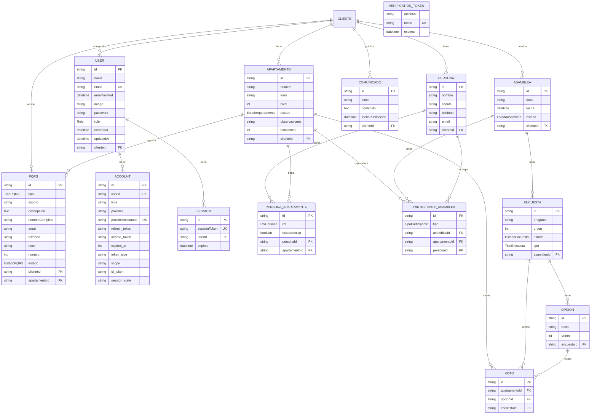

# Sistema GAPH - Gestión de Apartamentos y Asambleas

Sistema de gestión para unidades residenciales con funcionalidades de administración de apartamentos, personas, asambleas, voting digital, comunicados y PQRS.

## Características

### Panel de Administración (`/dashboard`)
- **Apartamentos**: CRUD de apartamentos con número, torre y nivel
- **Personas**: Gestión de residentes con identificación
- **Asambleas**: 
  - Crear y gestionar asambleas
  - Registrar participantes (nombre, cédula, torre, apartamento)
  - Crear encuestas (binarias o múltiples)
  - Votación en tiempo real
  - **Resultados con gráficos visuales** y botón de actualizar
- **Comunicados**: Publicación de anuncios a residentes
- **PQRS**: Gestión de peticiones, quejas, reclamos y sugerencias con cambio de estado

### Portal Público
- **Selección de unidad residencial**: Pantalla de bienvenida para seleccionar la comunidad
- **Identificación de participante**: Login mediante cédula
- **Votación**: Acceso a encuestas activas de la asamblea
- **PQRS público**: Formulario sin login para enviar solicitudes (tipo, asunto, descripción, nombre, torre, apartamento, email, teléfono)

## Tech Stack

- **Framework**: Next.js 16.2.0 (App Router)
- **UI**: React 19.2.4 + Tailwind CSS v4 + shadcn/ui
- **Backend**: Supabase (PostgreSQL + Realtime + Auth)
- **ORM**: Prisma ORM (conectado a Supabase PostgreSQL)
- **Autenticación**: NextAuth.js v5 (Auth.js) + Supabase Auth
- **Realtime**: Supabase Realtime para votos en tiempo real
- **Testing**: Vitest (unit/integration) + Playwright (E2E)

## Estructura del Proyecto

```
src/
├── app/
│   ├── (admin)/         # Rutas del panel de administración (protegidas)
│   │   ├── dashboard/   # Dashboard principal
│   │   ├── personas/    # Gestión de personas (CRUD)
│   │   │   └── [id]/    # Editar persona
│   │   ├── apartamentos/ # Gestión de apartamentos (CRUD)
│   │   │   └── [id]/    # Editar apartamento
│   │   ├── asambleas/   # Gestión de asambleas y encuestas
│   │   │   └── [id]/
│   │   │       └── resultados/ # Página de resultados
│   │   ├── comunicados/ # Gestión de comunicados
│   │   └── pqrs/        # Lista y gestión de PQRS
│   ├── (public)/        # Rutas públicas
│   │   ├── page.tsx    # Landing page con selector de unidad
│   │   ├── unidad/     # Portal por unidad residencial
│   │   ├── votar/     # Sistema de votación público
│   │   │   └── [asambaId]/ # Votación por asamblea
│   │   └── contacto/   # Formulario público de PQRS
│   ├── login/          # Página de login
│   ├── api/            # API routes (auth, etc.)
│   └── page.tsx        # Redirect raíz
├── components/
│   └── ui/             # Componentes shadcn/ui
├── lib/
│   ├── actions/        # Server Actions de Next.js
│   ├── schemas/        # Validación Zod
│   └── db.ts           # Cliente Prisma
└── generated/
    └── prisma/         # Cliente Prisma generado
```

## Entidades y Relaciones

> **Nota**: La base de datos es PostgreSQL en Supabase. Las tablas incluyen soft deletes (`deletedAt`) para compatibilidad con el backend de Supabase.

### Modelo Entidad-Relación



### Descripción de Entidades

| Entidad | Descripción | Atributos Principales |
|---------|-------------|---------------------|
| **Cliente** | Unidad residencial o conjunto | `id`, `nombre` |
| **Apartamento** | Unidad habitacional | `numero`, `torre`, `nivel`, `estado` (PROPIO/ARRIENDO/VACIO) |
| **Persona** | Residente o propietario | `nombre`, `cedula`, `telefono`, `email` |
| **PersonaApartamento** | Relación Persona-Apartamento | `rol` (PROPIETARIO/APODERADO/RESIDENTE), `estadoActivo` |
| **Asamblea** | Junta de propietarios | `titulo`, `fecha`, `estado` (ABIERTA/CERRADA) |
| **ParticipanteAsamblea** | Participante registrado en asamblea | `tipo` (PROPIETARIO/APODERADO) |
| **Encuesta** | Sondeo en una asamblea | `pregunta`, `tipo` (BINARIA/MULTIPLE), `estado` (ACTIVA/CERRADA) |
| **Opcion** | Opción de respuesta | `texto`, `orden` |
| **Voto** | Voto registrado | Único por (apartamento, encuesta) |
| **Comunicado** | Anuncio publicado | `titulo`, `contenido`, `fechaPublicacion` |
| **PQRS** | Petición/Queja/Reclamo/Sugerencia | `tipo`, `asunto`, `descripcion`, `estado` |
| **User** | Usuario administrador | `name`, `email`, `password`, `role` (USER/ADMIN) |
| **Account** | Cuenta OAuth/credenciales | Proveedor de autenticación |
| **Session** | Sesión activa | Token de sesión con expiración |

### Enums (Valores permitidos)

| Enum | Valores |
|------|---------|
| **EstadoApartamento** | `PROPIO`, `ARRIENDO`, `VACIO` |
| **RolPersona** | `PROPIETARIO`, `APODERADO`, `RESIDENTE` |
| **EstadoAsamblea** | `ABIERTA`, `CERRADA` |
| **TipoParticipante** | `PROPIETARIO`, `APODERADO` |
| **EstadoEncuesta** | `ACTIVA`, `CERRADA` |
| **TipoEncuesta** | `BINARIA`, `MULTIPLE` |
| **TipoPQRS** | `PREGUNTA`, `QUEJA`, `RECLAMO`, `SUGERENCIA` |
| **EstadoPQRS** | `PENDIENTE`, `RESUELTO`, `RECHAZADO`, `SIN_LEER` |
| **Role** | `USER`, `ADMIN` |

### Reglas de Negocio Clave

1. **Un apartamento = un voto por encuesta**: La tabla `Voto` tiene índice único en `(apartamentoId, encuestaId)` para garantizar que cada apartamento vote solo una vez por pregunta.

2. **Un representante por apartamento en asamblea**: La tabla `ParticipanteAsamblea` tiene índice único en `(asambleaId, apartamentoId)` para que solo un representante vote por apartamento.

3. **Una persona por cédula por cliente**: La tabla `Persona` tiene restricción única en `(cedula, clienteId)` para evitar duplicados.

4. **Apartamento único por torre y número**: La tabla `Apartamento` tiene restricción única en `(numero, torre, clienteId)`.

## Testing

El proyecto cuenta con una suite completa de testing:

### Tests Unitarios (Vitest)

```bash
npm test
```

| Carpeta | Descripción |
|---------|-------------|
| `tests/schemas/` | Validación de Zod schemas |
| `tests/actions/` | Server Actions mockeadas |

### Tests E2E (Playwright)

```bash
npm run test:e2e
```

Los tests E2E cubren:
- Login y autenticación
- Navegación entre páginas
- Formulario público de PQRS

## Primeros Pasos

### Requisitos Previos
- Node.js 18+
- Cuenta de Supabase (gratuita)

### Instalación

1. Clonar el repositorio:
```bash
git clone <repo-url>
cd sistema-gaph
```

2. Crear proyecto en Supabase:
   - Ir a [supabase.com](https://supabase.com) y crear un proyecto nuevo
   - Obtener las credenciales del proyecto (URL, keys)

3. Configurar variables de entorno:
```bash
cp .env.example .env
# Editar .env con las credenciales de Supabase
```

4. Configurar el connection string en `.env`:
   - Usar el **Transaction Pooler** de Supabase para producción
   - Usar **Direct Connection** para migraciones

5. Generar el cliente Prisma:
```bash
npx prisma generate
```

6. Aplicar migraciones:
```bash
npx prisma migrate dev
```

7. Iniciar el servidor de desarrollo:
```bash
npm run dev
```

8. Abrir http://localhost:3000

### Variables de Entorno Requeridas

| Variable | Descripción |
|----------|-------------|
| `NEXT_PUBLIC_SUPABASE_URL` | URL del proyecto Supabase |
| `NEXT_PUBLIC_SUPABASE_PUBLISHABLE_DEFAULT_KEY` | Clave pública de Supabase |
| `SUPABASE_SERVICE_ROLE_KEY` | Clave de servicio (solo backend) |
| `DATABASE_URL` | Connection string con pooling |
| `DIRECT_URL` | Connection string directa (para migraciones) |

## Scripts Disponibles

| Comando | Descripción |
|---------|-------------|
| `npm run dev` | Iniciar servidor de desarrollo |
| `npm run dev:turbo` | Iniciar con Turbopack |
| `npm run build` | Construir para producción |
| `npm run start` | Iniciar servidor de producción |
| `npm run lint` | Ejecutar ESLint |
| `npm test` | Ejecutar tests unitarios |
| `npm run test:coverage` | Coverage de tests |
| `npm run test:e2e` | Ejecutar tests E2E |
| `npm run test:e2e:ui` | Tests E2E con UI interactiva |
| `npx prisma studio` | Abrir interfaz de Prisma |

## Contribuir

1. Crear una rama para la feature (`git checkout -b feature/nueva-funcionalidad`)
2. Hacer commit de los cambios (`git commit -m 'feat: agregar funcionalidad'`)
3. Push a la rama (`git push origin feature/nueva-funcionalidad`)
4. Abrir un Pull Request

## Licencia

Privado - Todos los derechos reservados
